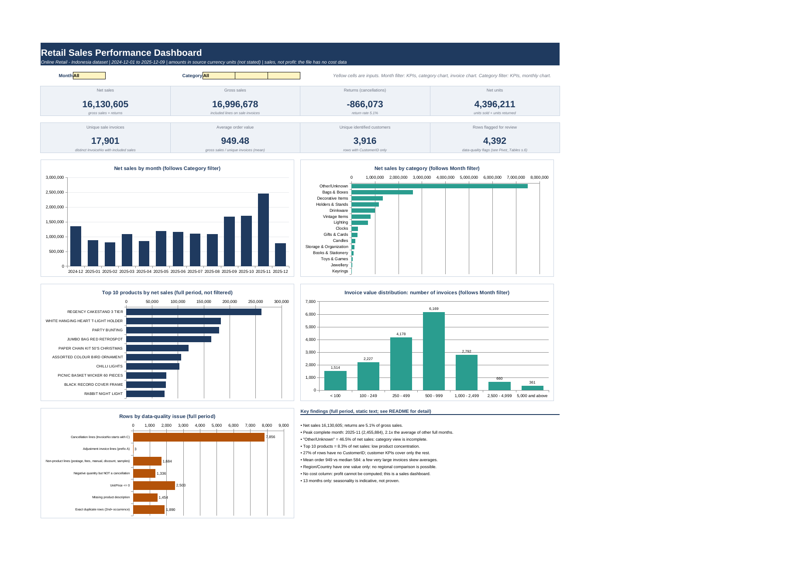

# da-retail-sales-performance-analytics

## Retail Sales Performance Workbook (Excel)

An end-to-end Excel analysis of a retail transaction file (`Online Retail - Indonesia.csv`, 495,478 rows x 9 columns, 2024-12-01 to 2025-12-09). One dataset, one workbook: audit, cleaning, formula-driven analysis, summary tables and an interactive dashboard.

## What is in `Retail_Sales_Analytics.xlsx`

| Sheet | Purpose |
|---|---|
| `README` | Questions, method, KPI definitions, findings, limitations, verification notes |
| `Raw_Data` | Source rows exactly as provided (no edits) |
| `Cleaned_Data` | Same rows one-to-one; formulas for date parsing, text cleaning, sales amount, invoice type, VLOOKUP classification, inclusion rule; documented static flags |
| `Data_Dictionary` | Every column: definition, type, source, transformation |
| `Analysis` | Filter engine, KPI cross-check, dataset audit, row accounting, business questions, 18 validation checks |
| `Pivot_Tables` | Formula-driven summaries (SUMIFS/COUNTIFS/INDEX-MATCH). Not native PivotTables |
| `Dashboard` | 8 KPIs, 5 charts, Month and Category dropdown filters |

Excel skills shown: SUM/AVERAGE/MIN/MAX/COUNT/COUNTA, SUMIFS/COUNTIFS/AVERAGEIF, TRIM/CLEAN/SUBSTITUTE/UPPER/LEFT/MID, IF/IFS/AND/OR/IFERROR, VLOOKUP and INDEX/MATCH (both with a real purpose), YEAR/MONTH/DATE/EOMONTH/EDATE/WEEKDAY, SUMPRODUCT array checks, named ranges, data validation dropdowns, native charts.

## Key facts about the data (audit)

- Grain: one row = one product line on an invoice (23,494 distinct InvoiceNo, about 21 lines each). `InvoiceNo` is not a row key.
- `Region` and `Country` each hold a single value, so regional analysis is impossible.
- No cost, margin or profit column: **profit cannot be computed**. This is a sales (revenue) analysis; revenue is never labelled profit.
- Currency is not stated in the file and is not converted.
- 7,856 cancellation lines (InvoiceNo prefix `C`, all negative quantity), 3 adjustment lines (prefix `A`), 1,336 negative-quantity rows that are not cancellations, 2,503 rows with price <= 0, 1,454 blank descriptions, 1,890 exact duplicate rows (flagged, kept), 133,600 rows without CustomerID.
- "Other/Unknown" is the label for 48% of rows and 46.5% of net sales.

## Definitions

- Line amount = `ROUND(Quantity x UnitPrice, 2)`.
- Included in sales metrics: not an adjustment invoice, not on the documented non-product rule table (postage, fees, manual entries, discounts, samples), UnitPrice > 0. Every excluded row stays in `Cleaned_Data` with an `Exclusion_Reason`.
- Gross sales = included sale lines; returns = included cancellation lines; net sales = gross + returns.
- Average order value = gross sales / unique sale invoices (mean).

## Findings (full period)

| Metric | Value |
|---|---|
| Net sales | 16,130,605 (gross 16,996,678, returns 866,073, return rate 5.1%) |
| Sale invoices / identified customers | 17,901 / 3,916 |
| Average vs median order value | 949 vs 584 |
| Peak complete month | 2025-11 (2,455,884), 2.1x the average of other complete months |
| Top 10 products | 8.3% of net sales (low product concentration) |
| Top 10% of identified customers | 58% of identified net sales (high customer concentration) |

Seasonality cannot be confirmed with 13 months of data. Wednesdays have no records at all, so weekday patterns should not be read as real behaviour. The dates may be re-based or synthetic.

## Provenance and licence

The file's origin is unverified. Its structure and product wording resemble a well-known public online-retail dataset, and the constant Country/Region values suggest it is not data from a real Indonesian company. Do not present it as one. Check the licence and redistribution terms before committing the raw data to a public repository. The workbook is about 85 MB; use Git LFS or publish only a sample of `Raw_Data`.

## Limitations

- No native PivotTables and no Excel Tables/structured references (generated programmatically; the two big sheets use named ranges `cd_*`, `raw_*`).
- Some helper columns are static values computed in pandas (data-quality flags, first-occurrence flags, invoice net value, customer decile table). They are documented and reconciled by array formulas in `Analysis` section 7.
- Top-20 product list and category order are fixed at build time; their amounts are live formulas.
- Excel 2019 / Microsoft 365 is required (IFS). Opening recalculates about 3 million formulas.
- Not tested in desktop Microsoft Excel.

## Repository contents

| Path | What it is |
|---|---|
| `data/` | Raw CSV used in this project (unchanged) and notes on its source. Origin and licence unverified |
| `docs/` | `dashboard.png` (rendered with LibreOffice, not an Excel screenshot) and `VALIDATION_SUMMARY.md` (what was and was not tested) |
| `workbook/` | `Retail_Sales_Analytics_SAMPLE.xlsx`: small working copy built from a random sample of 900 invoices (19,753 rows) with the same sheets, formulas and dropdowns. Its numbers differ from the full-period figures above |

The full workbook (about 85 MB) is not stored in the repository because of GitHub file-size limits.
